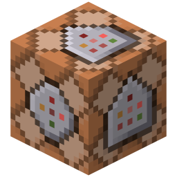
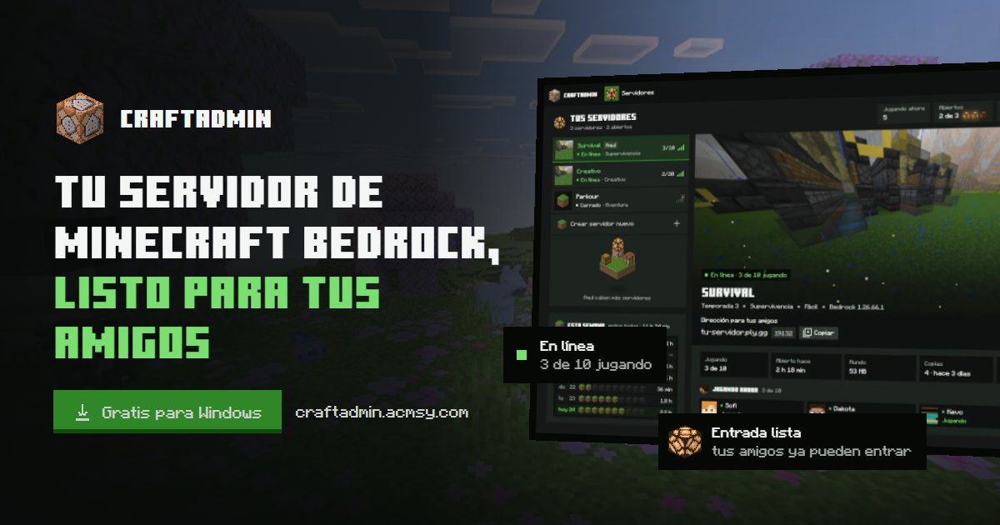
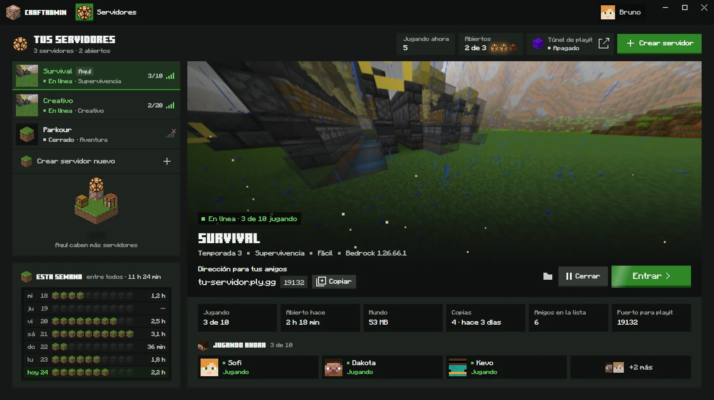
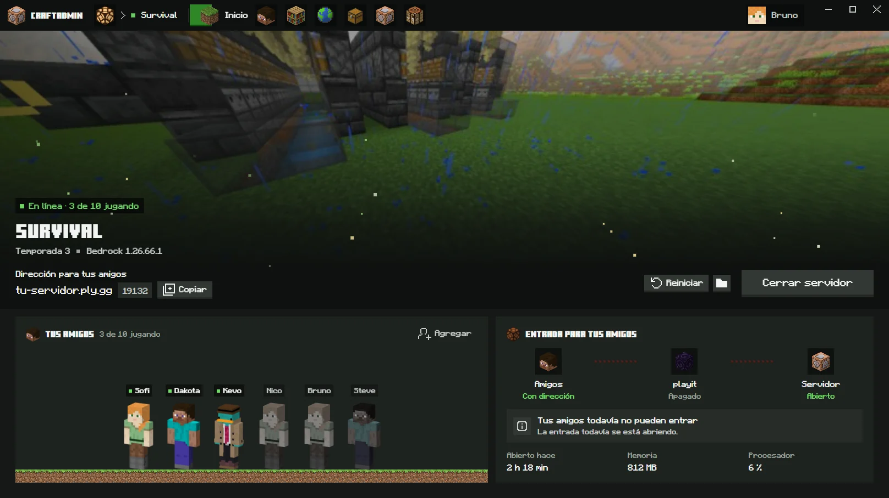
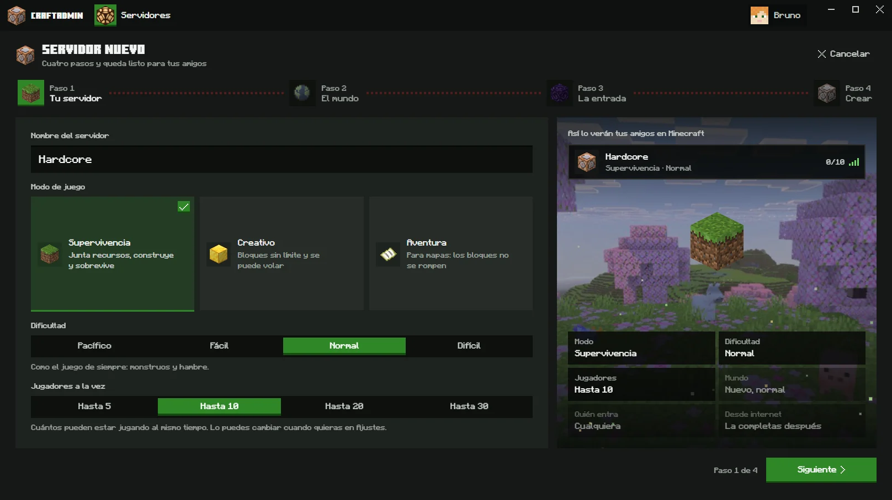
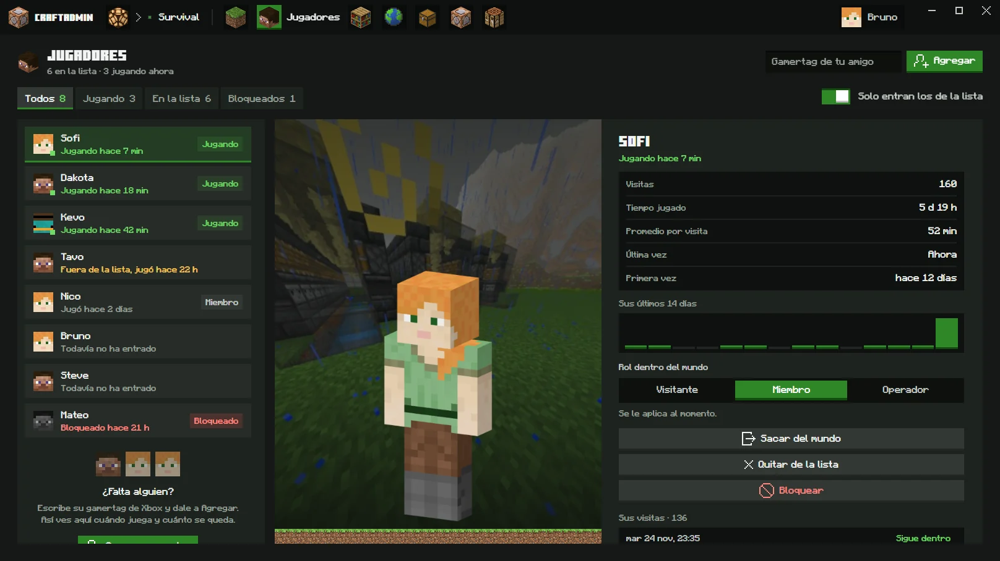

<div align="center">



# CraftAdmin

**Tu servidor de Minecraft Bedrock, listo para tus amigos.**

App de escritorio para Windows que crea y administra servidores de Minecraft Bedrock en tu PC:<br />
varios servidores a la vez, mundos, copias, jugadores y la entrada por internet sin tocar el router.

[**craftadmin.acmsy.com**](https://craftadmin.acmsy.com)

<br />


<br />



</div>

<br />

## Qué hace

| | |
|---|---|
| **Varios servidores** | Un survival, un creativo y un parkour abiertos a la vez, cada uno con su carpeta, su mundo, sus copias y su propia entrada. La pantalla de servidores muestra cuáles están abiertos, quién juega y la semana de todos. |
| **Asistente de cuatro pasos** | Nombre, modo, dificultad y jugadores; un mundo nuevo, uno de tu Minecraft, la copia de otro servidor o un `.mcworld`; quién entra y con qué rol. Lo que falte en el PC se baja solo. |
| **Entrada para tus amigos** | Conectas playit una vez y la app crea el túnel NetherNet de cada servidor por su API: la dirección, el puerto UDP y la clave quedan puestos solos. Nada de abrir puertos del router. |
| **Mundos y copias** | Importa y exporta mundos con los paquetes que usan. Copias en frío y en caliente con `save hold`, una antes de cada apertura y cada cierto número de horas. |
| **Jugadores** | Quién juega y quién ha entrado, en 3D con su skin; roles de visitante, miembro u operador; bloqueos e historial de visitas por día. |
| **Consola y estado** | Consola en vivo, consumo de CPU y memoria, reinicio automático si el servidor se cae e instalación o actualización del servidor oficial. |
| **Tu cuenta** | Correo y contraseña dentro de la app o Google en el navegador. Tu skin sale de la que tienes puesta en Minecraft con un clic. |

<br />

## Capturas

<table>
  <tr>
    <td width="50%"></td>
    <td width="50%"></td>
  </tr>
  <tr>
    <td align="center"><sub><b>Servidores</b> · la lista de la izquierda y la vista grande del elegido</sub></td>
    <td align="center"><sub><b>Inicio</b> · la foto del mundo, la dirección y los amigos de pie sobre el pasto</sub></td>
  </tr>
  <tr>
    <td width="50%"></td>
    <td width="50%"></td>
  </tr>
  <tr>
    <td align="center"><sub><b>Asistente</b> · un servidor nuevo en cuatro pasos</sub></td>
    <td align="center"><sub><b>Jugadores</b> · cada amigo con su skin, su rol y lo que ha jugado</sub></td>
  </tr>
</table>

<br />

## Diseño

CraftAdmin se ve como el launcher de Minecraft: oscuro, con tono verde y las letras del propio juego.

- **Hecho con el juego de cada quien.** Las texturas, los íconos de los menús y las letras salen del Minecraft Bedrock instalado la primera vez que se abre la app; el paquete no reparte archivos del juego.
- **Pixel art de verdad.** Los íconos son bloques en 3D dibujados pixel por pixel en la vista del inventario, y los jugadores se arman caja por caja a partir de su skin.
- **Plano.** Esquinas rectas, sin sombras, sin bordes marcados y sin brillos: la jerarquía sale del fondo y del espacio.
- **Nada salta de lugar.** Las listas nunca pasan de una fila a dos; lo que sobra se muestra como «+N más». El espacio que todavía no se usa lo ocupa una isla en pixel art.
- **Movimiento con intención.** Figuras que caen, torres de bloques que brotan, contadores y partículas sobre la foto del mundo.

<br />

## Cómo funciona

| Pieza | Tecnología | Qué hace |
|---|---|---|
| App de escritorio | **Electron 44**, HTML, CSS y JavaScript sin frameworks | Una instancia por servidor; la interfaz habla con el proceso principal por un solo canal con una lista cerrada de operaciones |
| Servidor | **Bedrock Dedicated Server** 1.26 | El servidor oficial; la app lo abre, lee su consola y le manda comandos |
| Entrada | **WaterdogPE** sobre Java 21 | Recibe a los jugadores por NetherNet y los pasa al servidor; Bedrock 1.26 solo acepta NetherNet |
| Túnel | **playit.gg** | Un túnel por servidor creado por API con un agente autogestionado |
| Cuentas | **Node 22** con `node:http` y **MySQL 8** | Registro, entrada con Google, sesiones y skins; también sirve la página de descarga |
| Página | HTML, **GSAP** y **Lenis** | El recorrido animado y la descarga del `.zip` |

<br />

## Estructura

```
app/
  main.js            Instancias de cada servidor, asistente, túneles y la API para la interfaz
  preload.js         El puente con la interfaz
  src/               servidor · mundos · copias · jugadores · playit · túneles · WaterdogPE
                     entradas · skins · cuenta · descargas · piezas del juego · ajustes
  renderer/          Interfaz: secciones, servidores y asistente, cuenta, pixel art y estilos
  plantillas/        Configuración base de WaterdogPE, sin claves
  tools/             Empaquetador del .zip y herramientas del ícono
cuentas/
  server.js          API de cuentas, entrada con Google, skins y descarga
  publico/           La página de descarga
  Dockerfile         Imagen sobre node:22-slim
```

Al usarse, la app crea junto a `app/` las carpetas `servidores/`, `playit/`, `datos/` y `backups/`, que no van al repositorio.

<br />

## Cómo correr en local

Necesitas **Windows 10 u 11**, **Minecraft Bedrock** instalado y **Node 22+**.

```bash
cd app
npm install
npx electron .
```

El servidor oficial, playit, Java 21 y WaterdogPE se bajan solos al crear el primer servidor.

Para armar el `.zip` descargable:

```bash
node tools/empaquetar.js
```

El servicio de cuentas corre aparte:

```bash
cd cuentas
npm install
node server.js
```

<br />

## Variables de entorno

| Variable | Para qué |
|---|---|
| `DB_HOST` · `DB_PORT` · `DB_USER` · `DB_PASSWORD` · `DB_NAME` | La base MySQL de las cuentas |
| `SESSION_SECRET` | Firma de los resúmenes de las sesiones |
| `PUBLIC_URL` | URL pública del servicio, para el retorno de Google |
| `GOOGLE_CLIENT_ID` · `GOOGLE_CLIENT_SECRET` | Entrar con Google (opcional) |
| `PORT` | Puerto del servicio (3000 por defecto) |
| `CRAFTADMIN_CUENTAS` | En la app: otro servicio de cuentas, por ejemplo uno local |
| `CRAFTADMIN_MINECRAFT` | En la app: la carpeta `data` de Minecraft si no está en `XboxGames` |

Las claves nunca se suben al repositorio.
